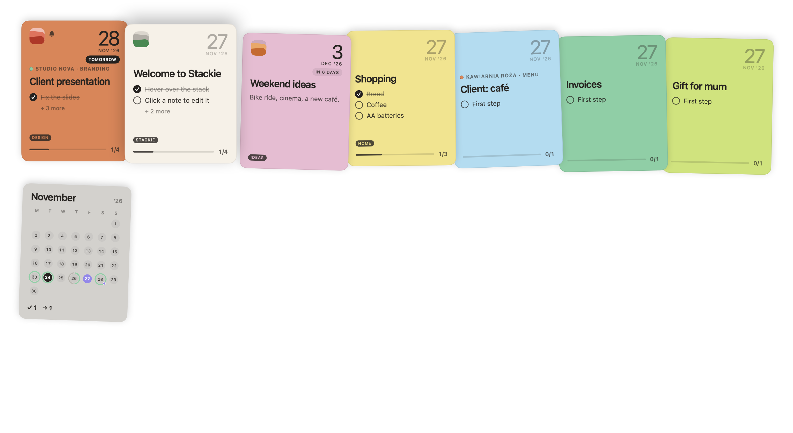
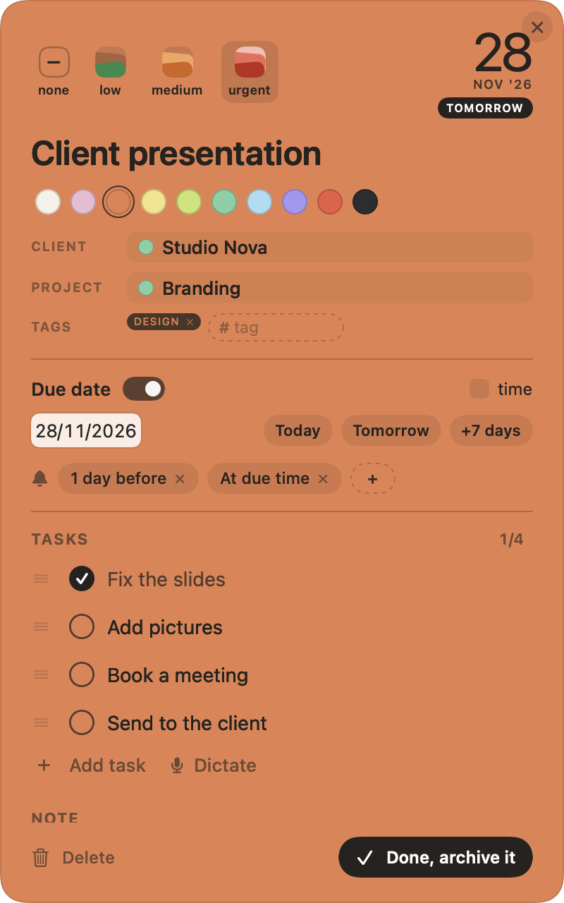
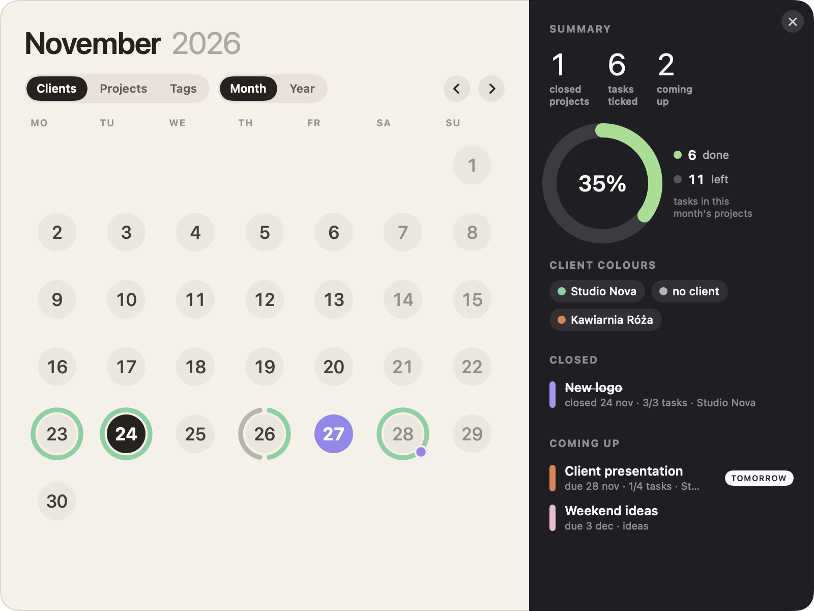

# Stackie

**Sticky notes for your Mac desktop, stacked like a deck of cards.**
Hover over the stack and it fans out. Every note is a small project with tasks, a client, tags, a deadline and reminders.

Polska wersja nazywa się **Stosik**: opis po polsku jest niżej.

### ⬇️ [Download Stackie for Mac / Pobierz](https://github.com/woreczko/stackie/releases/latest)

Open the link, then click **Stackie-….zip** under *Assets*. Unzip and drag the app to Applications.
Otwórz link i kliknij **Stackie-….zip** w sekcji *Assets*. Rozpakuj i przeciągnij apkę do Aplikacji.



## Features

- **A deck of notes on your desktop.** Folded, you see three cards (Today, a note and the calendar); hover and they fan out (in rows on smaller screens). Three stack sizes and small notes for laptops.
- **Today card** at the front: everything due today, grouped by client and project. It returns to the front every morning.
- **Make tasks with Claude.** Click ✨ *Make tasks* in a messy note and Claude turns it into tasks with client, project and deadline (you approve the proposal first). Needs the Stackie password or your own Claude API key.
- **Quick note from a screen corner** of your choice.
- **Projects with tasks.** Tick the circles, watch the progress bar, drag tasks to reorder.
- **Client, project and tags**, each with its own colour. Click one to filter the stack. Search across everything.
- **Priority** in three colours, shown as a small layered icon.
- **Deadlines and reminders** like in Calendar: several per note, preset intervals or an exact time. Notes with a close deadline hop in the stack; the bell on the note lets you snooze or mute.
- **Calendar card** at the end of the stack: month and year views, day rings by client, project or tag, and a done-vs-left summary.
- **Files on notes.** Drop a PDF, a photo or any file onto an open note; Stackie keeps its own copy, so moving the original doesn't break anything.
- **30-day bin.** Drag a note down onto the bin; restore it any time within 30 days.
- **Dictation.** Click the mic and say what needs doing: each verb starts a new task, and “client …”, “project …”, “tag …” and spoken deadlines fill in the fields (best in Polish).
- **Updates itself.** At launch and at 10:37 and 21:37 it checks for a new version and installs it while you're away (only builds signed by the same developer). Or check right away: Settings → Check for updates. You can turn automatic updates off in the menu.
- **Polish and English**, switchable without restarting (follows the system by default).

<p>


</p>

## Install

1. Download **Stackie-1.4.1.zip** from [Releases](../../releases).
2. Unzip it and move **Stosik.app** to **Applications** (on an English Mac it shows as *Stackie*).
3. Double-click to open. The app is signed and notarized by Apple, so macOS opens it without warnings.
4. Stackie lives in the menu bar and on your desktop (no Dock icon). A welcome window shows what it can do and asks for the permissions it needs (notifications for reminders, microphone and speech recognition for dictation).

Requires macOS 14 or later. Works on Apple Silicon and Intel Macs.

## Build from source

You need the Xcode command line tools (`xcode-select --install`).

```bash
./zbuduj.sh            # builds, installs to ~/Applications and launches
./zbuduj.sh --tylko-buduj   # build only (into build/)
./testuj.sh            # screenshots in Polish and English into test/, using a separate data folder
```

Your notes are stored in `~/Library/Application Support/Stosik/`.

---

## Po polsku: Stosik

**Karteczki na pulpicie Maca, ułożone w stos jak talia kart.** Najedź myszką, a stos się rozłoży. Każda karteczka to projekt z zadaniami, klientem, tagami, terminem i przypomnieniami. Możesz do niej dołączać pliki: PDF-y, zdjęcia i inne. Kartka „Na dziś”, zadania z chaotycznej notatki dzięki Claude, szybka karteczka z rogu ekranu i trzy rozmiary stosu. Nowe wersje instalują się same.

- **Instalacja:** pobierz **Stackie-1.4.1.zip** z zakładki [Releases](../../releases), rozpakuj i przenieś **Stosik.app** do **Aplikacji**.
- **Pierwsze uruchomienie:** otwórz dwuklikiem. Apka jest podpisana i sprawdzona przez Apple, więc macOS jej nie blokuje.
- **Gdzie jest:** Stosik siedzi w pasku menu i na pulpicie, bez ikony w Docku. Okienko powitalne pokaże, co umie, i poprosi o zgody: powiadomienia do przypomnień oraz mikrofon i rozpoznawanie mowy do dyktowania.
- **Wymagania:** macOS 14 albo nowszy, Mac z Apple Silicon albo z Intelem.

Opis kodu i proces wydawania nowych wersji: [CZYTAJ.md](CZYTAJ.md).
